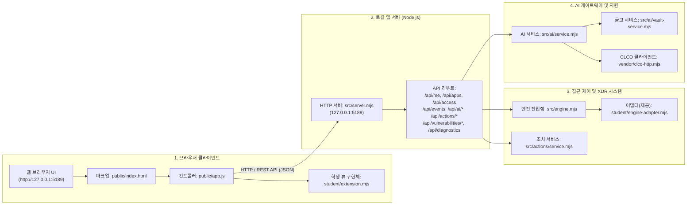

# 보안 Agent 「쉴더스진」 학생용 실행 설명서 및 시스템 구성도

이 문서는 보안 Agent 「쉴더스진」(alekov-client-starter 기반)의 실행 환경, 작업 위치, 실행 절차, 시스템 구조, 제공 코드 및 학생 구현 경계, 장애 진단 방법을 설명합니다.

---

## 1. 개요 및 제품 범위

### 1.1. 프로젝트 개요
보안 Agent 「쉴더스진」은 사내 직원이 개인 식별 정보, 등록 기기 및 활성 세션 상태, 업무 애플리케이션 접근 판정, XDR 보안 경보 및 이벤트, AI 기반 보안 사건 설명, 대응 조치 실행 상태, 패키지 취약점 진단 결과를 안전하게 열람하고 관리할 수 있도록 제공되는 데스크톱 보안 클라이언트 애플리케이션입니다.

- **프로젝트 명**: choi-bujang-secret-vault (보안 Agent 「쉴더스진」)
- **클라이언트 패키지**: `alekov-client-starter` (버전 0.2.11)
- **목적**: 제로 트러스트(ZTNA) 및 SDP/XDR 환경에서의 엔드포인트 보안 상태 가시성 확보 및 안전한 보안 대응

### 1.2. 저장소 내 제품 범위 및 의존성 관계
본 저장소(`choi-bujang-secret-vault`)는 1~12단계 백엔드 API와 13~22단계 엔드포인트 보안 Agent 클라이언트가 공존하는 복합 저장소입니다.

1. **보안 Agent 클라이언트 (13~22단계 제품)**:
   - **담당 경로**: `src/server.mjs`, `src/*`, `public/*`, `student/extension.mjs`, `student/engine-adapter.mjs`
   - **실행 환경**: Node.js 내장 모듈(루프백 `http://127.0.0.1:5189`)로 구동되며, 클라이언트 자체 실행에는 외부 npm 패키지가 요구되지 않습니다.
2. **백엔드 API 및 로그인 검증 모듈 (1~12단계 제품)**:
   - **담당 경로**: `api/notes.js`, `api/notes/[id].js`, `api/notes/restore.js`, `api/threat-intel.js`, `src/verify-login.mjs`, `src/decider.mjs`
   - **실행 환경**: Supabase 클라우드 데이터베이스 및 비대칭 키(JWKS) 기반 JWT 토큰 검증을 수행하며, Vercel 서버리스 런타임 또는 로컬 Node.js 환경에서 구동됩니다.
   - **외부 의존성**: `package.json` 및 `package-lock.json`에 명시된 `@supabase/supabase-js` (^2.117.2) 및 `jose` (^6.2.12) 패키지에 의존합니다.

---

## 2. 필요 프로그램 및 실행 환경

`package.json`의 `engines` 설정, `docs/STUDENT_LAUNCH_GUIDE.md`, 그리고 `tools/start-alekov.ps1`의 실제 지원 범위를 일치시켜 관리합니다.

| 구분 | 사양 및 범위 | 비고 |
|---|---|---|
| **Node.js 지원 범위** | `Node.js 22 ~ 24` (`>=22.0.0 <=24.x`) | `package.json` engines 및 PowerShell 실행 도구 호환 범위 |
| **수업 기준 및 권장 버전** | `v24.19.0` (LTS 권장) | `docs/STUDENT_LAUNCH_GUIDE.md` 2장 공식 기준 |
| **실제 확인 버전** | `v24.13.0` | 현재 개발 PC 환경에서 구동 및 문법 검사 확인 |
| **npm 버전** | `10.x` 이상 (`v11.6.2` 확인) | 패키지 의존성 및 스크립트 실행 관리 |
| **운영체제** | Windows 10/11 (PowerShell 5.1 / 7.x) | 루프백(127.0.0.1) 로컬 바인딩 |
| **외부 패키지 의존성** | `@supabase/supabase-js` (^2.117.2)<br/>`jose` (^6.2.12) | 백엔드 API(`api/notes.js`) 및 로그인 검증(`src/verify-login.mjs`)에 필요하며 `package-lock.json`에 잠김 |

---

## 3. 작업 디렉터리 구조

프로젝트 최상위 폴더는 아래와 같은 계층 구조로 구성되어 있습니다.

```text
choi-bujang-secret-vault/
├── package.json                    # 프로젝트 메타데이터, scripts 및 dependencies/engines 정의
├── package-lock.json               # @supabase/supabase-js, jose 등 잠금 파일
├── aleph.config.json               # 검수 및 플랫폼 설정 파일
├── README.md                       # 프로젝트 개요 및 기본 안내
├── .on-starter-manifest.json       # 시작 틀 파일 원본 해시 목록
├── student/                        # [학생 폴더]
│   ├── extension.mjs               # [학생 구현 코드] UI 렌더링 함수 구현체 (renderIdentity ~ renderVulnerabilities)
│   └── engine-adapter.mjs          # [제공 코드] 로컬 엔진-어댑터 인터페이스 (매니페스트 시작 틀 해시와 일치)
├── src/                            # [제공 코드: 백엔드 서버 및 엔진]
│   ├── server.mjs                  # 로컬 HTTP 앱 서버 (루프백 127.0.0.1:5189)
│   ├── engine.mjs                  # SDP/XDR 엔진 진입점
│   ├── actions/                    # 보안 조치 처리 모듈
│   ├── ai/                         # 로컬 AI 연동 및 자격 증명 금고 모듈
│   ├── connection/                 # 네이티브 컨텍스트 및 로그인 모듈
│   ├── learner-support/            # 학습 지원 서비스
│   ├── vulnerabilities/            # 패키지 스캔(project-scan.mjs) 및 OSV 취약점 분석(osv.mjs)
│   ├── verify-login.mjs            # 1~12단계 JWT 로그인 검증기 (jose, supabase-js 사용)
│   └── decider.mjs                 # 1~12단계 접근 제어 정책 엔진
├── api/                            # [1~12단계 백엔드 API: Vercel 서버리스]
│   ├── notes.js                    # 메모 조회 및 생성 API (@supabase/supabase-js 사용)
│   ├── threat-intel.js             # 위협 인텔리전스 API
│   └── notes/                      # 상세 메모 관리 및 복구 API
├── public/                         # [제공 코드: 프론트엔드 UI 자원]
│   ├── index.html                  # 메인 웹 페이지 마크업
│   ├── app.js                      # 클라이언트 오케스트레이션 로직
│   ├── style.css                   # 공통 스타일시트
│   ├── ai-connect.mjs              # AI 연결 보조 컴포넌트
│   └── vulnerabilities-view.mjs    # 취약점 뷰 보조 컴포넌트
├── tools/                          # [제공 도구: 운영 보조 스크립트]
│   ├── start-alekov.ps1            # Node 22~24 확인 및 앱 기동용 PowerShell 스크립트
│   ├── prepare-native-host.ps1     # 네이티브 호스트 준비 스크립트
│   ├── native-host-registry.ps1    # 레지스트리 설정 스크립트
│   └── app-credentials.ps1         # 자격증명 보조 스크립트
├── vendor/                         # 외부 연동 HTTP 라이브러리 (clco-http.mjs)
└── docs/                           # 공식 문서 및 가이드라인
    ├── STUDENT_RUNBOOK.md          # [본 문서] 학생용 실행 설명서 및 시스템 구성도
    ├── REPRODUCTION_REPORT.md      # 22단계 새 환경 재현 및 릴리스 검증 보고서
    ├── STUDENT_LAUNCH_GUIDE.md     # 실행 및 Node.js 22~24 환경 안내서
    ├── IMPLEMENTATION_CONTRACT.md  # 인터페이스 계약 규격서
    ├── CURRICULUM.json             # 단계별 교육과정 및 검사 항목
    └── CONNECTION_TROUBLESHOOT.md  # 연결 문제 해결 안내서
```

---

## 4. 실행 및 재실행 절차

### 4.1. PowerShell 작업 경로
PowerShell 터미널을 열고 프로젝트 최상위 폴더로 이동합니다.
```powershell
Set-Location -Path "c:\Users\wlsdu\Desktop\SKT_ALEPH_personal_project\choi-bujang-secret-vault"
```

### 4.2. 실행 명령
상황에 맞게 아래 명령 중 하나를 실행합니다.

1. **PowerShell 전용 스크립트 실행 (Node 22~24 점검 및 기동)**
   ```powershell
   powershell -NoProfile -ExecutionPolicy Bypass -File .\tools\start-alekov.ps1
   ```

2. **기본 로컬 실행 (연결 확인 모드)**
   ```powershell
   npm start
   ```
   또는 직접 Node 명령 실행:
   ```powershell
   node src/server.mjs
   ```

3. **데모 모드 실행 (예제 목업 데이터 표출 모드)**
   ```powershell
   npm run demo
   ```
   또는:
   ```powershell
   node src/server.mjs --demo
   ```

4. **학생 구현 UI 문법 검사**
   ```powershell
   npm run check
   ```
   > [!IMPORTANT]
   > `npm run check` 명령은 `node --check student/extension.mjs`를 실행하여 **오직 학생 렌더링 코드(`student/extension.mjs`)의 자바스크립트 문법(syntax) 오류 여부만 검사**합니다. 취약점 스캐너, 잠금 파일(`package-lock.json`) 또는 백엔드 API 모듈은 검사하지 않습니다.

### 4.3. 브라우저 접속 및 정상 시작 신호
- **브라우저 접속 주소**: `http://127.0.0.1:5189`
- **정상 시작 신호 (터미널 출력)**:
  - 일반 모드: `케셰브 연결 확인: http://127.0.0.1:5189`
  - 데모 모드: `케셰브 예제: http://127.0.0.1:5189`

### 4.4. 종료 및 재실행 순서
1. **종료**: 실행 중인 PowerShell 창에서 `Ctrl + C`를 누르고, 일괄 작업 종료 여부에 `Y`를 입력합니다.
2. **재실행**: 종료 확인 후 동일한 PowerShell 창에서 다시 `npm start` 또는 `.\tools\start-alekov.ps1`을 실행합니다.

---

## 5. 시스템 구성도

### 5.1. 다이어그램 (Mermaid)



### 5.2. 구성 상자별 설명 (텍스트 표)

| 계층 번호 | 구성 요소 | 실제 담당 파일 경로 | 공개 엔드포인트 / 주소 | 비고 |
|---|---|---|---|---|
| **1** | 브라우저 클라이언트 | `public/index.html`<br/>`public/app.js`<br/>`student/extension.mjs` | `http://127.0.0.1:5189` | UI 렌더링, 이벤트 처리 및 학생 뷰(`student/extension.mjs`) 연결 |
| **2** | 로컬 앱 서버 | `src/server.mjs` | `http://127.0.0.1:5189/api/*` | 외부 의존성 없는 순수 Node.js HTTP 서버, 루프백 바인딩 |
| **3** | 접근 제어 및 XDR 시스템 | `src/engine.mjs`<br/>`student/engine-adapter.mjs`<br/>`src/actions/service.mjs` | 내부 모듈 호출 (In-Process) | 사용자 인증 상태 확인, 접속 판정, XDR 이벤트 및 조치 실행 관리 |
| **4** | AI 게이트웨이 / 수업용 AI | `src/ai/service.mjs`<br/>`src/ai/vault-service.mjs`<br/>`vendor/clco-http.mjs` | `/api/ai/connect/*`<br/>`/api/ai/explain` | AI 보안 사건 근거 설명 분석, 자격 증명 금고, 연결 상태 관리 |

> [!IMPORTANT]
> API 키, 패스워드, 토큰 등 기밀 정보는 소스코드 및 문서에 일체 포함하지 않으며, 로컬 파일(`.env` 등) 또는 운영 환경 설정으로 분리 보관됩니다.

---

## 6. 제공 코드와 학생 구현 영역 경계

`.on-starter-manifest.json` 해시 대조를 기준으로 제공 코드와 학생 구현 영역이 엄격히 구분됩니다.

### 6.1. 코드 영역 경계 (매니페스트 기준)

| 구분 | 파일 및 디렉터리 경로 | 매니페스트 상태 | 역할 및 담당 업무 |
|---|---|---|---|
| **제공 코드** | `student/engine-adapter.mjs` | 시작 틀 해시와 일치 | 로컬 앱 서버/엔진의 SDP 호스트 상태 및 이벤트를 클라이언트 뷰에 전달하는 브리지 인터페이스 |
| **제공 코드** | `src/*` (server, engine, ai, actions 등) | 시작 틀 해시와 일치 | HTTP 웹 서버 라우팅, SDP/XDR 엔진 로직, AI 게이트웨이 통신, 자격증명 금고 관리 |
| **제공 코드** | `public/*` (app.js, index.html, style.css 등) | 시작 틀 해시와 일치 | 웹 브라우저 마크업, 전역 이벤트 컨트롤러, 공통 스타일링 |
| **제공 코드** | `tools/*`, `vendor/*`, `docs/*` | 시작 틀 해시와 일치 | 실행 도구(`start-alekov.ps1`), 외부 통신 클라이언트, 공식 가이드 문서 |
| **학생 구현 영역** | `student/extension.mjs` | **학생 수정 코드** | 클라이언트 화면에 13~20단계 데이터를 표출하는 8개 UI 렌더링 함수 구현 |

### 6.2. 학생 구현 함수 목록 (`student/extension.mjs`)

| 단계 | 함수명 | 설명 및 역할 |
|---|---|---|
| **13단계** | `renderIdentity({ me, devices, sessions })` | 현재 사용자 계정(ID, 이름), 등록 기기(ID, 이름, 상태), 활성 세션 상태 정보를 DOM에 구성합니다. |
| **14단계** | `renderDecision({ status, mode, data, error, appId })` | 지정된 업무 앱에 대한 서버의 허용(`allow`), 거부(`deny`), 추가 확인(`challenge`), 확인 불가(`unknown`) 판정 결과를 명확한 텍스트로 표시합니다. |
| **15단계** | `renderEvents({ status, mode, data, error })` | XDR 접속 및 보안 이벤트 목록을 렌더링하고 개별 이벤트의 근거(evidence), 보안 규칙(rules), 상태(state)를 상세히 표출합니다. |
| **16단계** | `renderStatus({ devices, sessions, notifications, diagnostics, mode })` | 기기 목록, 활성 세션 목록, 시스템 알림, 진단(diagnostics) 정보를 정리하고 데이터 부재 시 빈 상태(Empty state)를 안내합니다. |
| **17단계** | `renderAiConnection({ status, mode, data, error, checkedAt, explanationAccepted })` | 앱 내부 AI 연결 라이프사이클(`connected`, `pending`, `checking`, `unapproved`, `failed`, `unknown`, `disconnected`)을 추적 및 표시합니다. |
| **18단계** | `renderExplanation({ event, explanation, checkedAt })` | 선택된 보안 사건에 대해 검증된 AI 위험도 분석과 이유(근거)를 기존 접속 판정과 분리하여 표시합니다. |
| **19단계** | `renderAction(actionState)` | 보안 조치(차단, 격리, 비밀번호 재설정 등)의 요청 진행 상태(`idle`, `requesting`, `succeeded`, `failed`, `unsupported`)와 실제 조치 결과를 구분하여 출력합니다. |
| **20단계** | `renderVulnerabilities({ status, mode, data, error })` | 의존성 패키지 점검 결과와 알려진 오픈소스 보안 취약점(CVE/GHSA) 정보를 심각도별로 분류하여 표시합니다. |

---

## 7. 장애 상황별 진단 및 복구 안내

화면에 나타날 수 있는 실패 문구와 스캐너/엔진 모듈(`src/vulnerabilities/project-scan.mjs` 등)의 실제 오류 처리 흐름에 따른 확인 순서는 다음과 같습니다.

| 화면 출력 문구 / 상태 | 발생 원인 (코드 기준) | 확인 및 복구 순서 |
|---|---|---|
| **연결 없음 (`disconnected`)**<br/>"기존 서버와 연결되지 않았습니다." | 로컬 서버는 정상 기동되었으나 상위 SDP/인증 호스트와의 세션이 연결되지 않은 기본 상태 | 1. `http://127.0.0.1:5189/api/diagnostics`를 호출하여 진단 정보를 확인합니다.<br/>2. 데모 화면 확인이 필요한 경우 `npm run demo`로 재실행합니다.<br/>3. 실제 연결 시 `docs/SDP_HOST_CONNECTION.md` 절차를 검토합니다. |
| **사용자 및 기기 식별 정보를 불러오지 못했습니다.** | `/api/me` 호출 응답이 실패(`ok: false`)하거나 네트워크 오류가 발생한 경우 | 1. PowerShell 콘솔에서 서버 프로세스 오류 로그를 확인합니다.<br/>2. 브라우저 개발자 도구의 네트워크 탭에서 `/api/me` 상태 코드를 확인합니다.<br/>3. 앱 재시작(`Ctrl + C` 후 `npm start`)을 시도합니다. |
| **접근 판정 결과를 불러오지 못했습니다.** | `/api/access` 엔드포인트 요청 시 서버 오류 또는 타임아웃 발생 | 1. 선택한 `appId`가 유효한지 확인합니다.<br/>2. 제공 어댑터(`student/engine-adapter.mjs`) 응답 상태를 점검합니다. |
| **확인 불가 (`unknown`)** | 서버에서 판정 기준 미달 또는 필수 검증 요소 누락으로 판정을 보류한 경우 | 1. 판정 이유(reason) 메시지를 확인합니다.<br/>2. 요청 데이터의 필수 파라미터가 누락되지 않았는지 확인합니다. |
| **권한 준비 중 (`unapproved`) / 승인 대기 (`pending`)** | AI 기능 사용 자격 승인이 진행 중이거나 관리자 승인이 완료되지 않은 상태 | 1. AI 연결 관리 탭에서 연결 ID 및 승인 상태를 확인합니다.<br/>2. `/api/ai/connect/status` 응답이 `checking` 중인지 조회합니다. |
| **AI 설명을 불러오지 못했습니다.** | 로컬 AI 게이트웨이 호출 실패 또는 모델 응답 불가 상태 | 1. AI 연결 상태가 `connected`인지 확인합니다.<br/>2. AI 실패는 기존 접속 및 이벤트 조회 기능과 독립적이므로 기본 기능은 정상 유지됩니다. |
| **보안 조치 실행 실패 (`failed`)** | 요청한 조치에 대해 권한이 부족하거나 지원되지 않는 조치 유형인 경우 | 1. 대상 이벤트의 `supportedActions` 목록을 확인합니다.<br/>2. 실행 상태가 `unsupported`인지 `failed`인지 상태 배지를 대조합니다. |
| **취약점 스캔 미확인 (`unverifiable`) / 부분 완료 (`partial`)** | `project-scan.mjs`의 OSV API(`lookupPackages`) 호출 10초 타임아웃 초과 또는 네트워크 단절 | 1. OSV API 통신 지연이나 네트워크 연결 단절 여부를 확인합니다.<br/>2. `node_modules` 내 각 패키지의 `package.json` 버전과 `package-lock.json` 간 메타데이터 일치 여부를 점검합니다. |
| **잠금 파일 확인 불가 (`LOCKFILE_UNVERIFIABLE`)** | `package-lock.json` 파일이 없거나 크기가 2MB를 초과하거나 v2/v3 형식이 아닌 경우 | 1. 프로젝트 루트에 `package-lock.json`이 존재하는지 확인합니다.<br/>2. 파일 크기가 2MB 이하인지, 손상되지 않은 유효한 JSON인지 점검합니다. |
| **승인 패키지 없음 (`NO_APPROVED_PACKAGES`)** | 호스트 설정의 `approvedPublicPackages` 목록이 비어 있는 경우 | 1. 호스트 환경 설정에 검사 대상 공개 패키지 목록이 승인되어 있는지 확인합니다. |
| **프로젝트 미설정 (`PROJECT_NOT_CONFIGURED`)** | 프로젝트 디렉터리 경로가 설정되지 않았거나 절대 경로가 아닌 경우 | 1. 로컬 앱 서버 기동 경로 및 프로젝트 작업 폴더 경로를 확인합니다. |
| **학생 UI 문법 오류 발생 시** | `student/extension.mjs` 코드 수정 중 구문 오류가 발생한 경우 | 1. `npm run check` 명령(`node --check student/extension.mjs`)을 실행하여 문법 오류 위치를 확인하고 수정합니다. |

---

## 8. 지원 범위 및 확인 상태

실제 프로젝트에서 검증된 범위와 향후 환경 연동을 위한 대기(UNV: Unverified) 항목은 아래와 같이 엄격히 분리하여 관리합니다.

| 구분 | 기능 및 항목 | 상태 | 설명 |
|---|---|---|---|
| **검증 완료 (VERIFIED)** | Node.js 22~24 로컬 서버 구동 | 확인됨 | Node.js `v24.13.0` 환경에서 루프백(`127.0.0.1:5189`) 정상 리슨 확인 (`package.json` engines 및 launch guide 일치) |
| **검증 완료 (VERIFIED)** | 학생 UI 확장 컴포넌트 문법 검사 | 확인됨 | `npm run check`(`node --check student/extension.mjs`) 실행을 통한 문법 무결성 확인 |
| **검증 완료 (VERIFIED)** | 데모 모드 UI 및 목업 렌더링 | 확인됨 | `npm run demo` 모드에서 13~20단계 컴포넌트 렌더링 로직 확인 |
| **검증 완료 (VERIFIED)** | 백엔드 API 의존성 패키지 정의 | 확인됨 | `package.json` 및 `package-lock.json`에 `@supabase/supabase-js`, `jose` 의존성 반영 완료 |
| **기다림 (UNV)** | 실제 운영 SDP 호스트 라이브 연동 | UNV | 상용 원격 SDP 엔드포인트와의 실시간 패킷 교환은 로컬 검수 범위 밖으로 미확인 유지 |
| **기다림 (UNV)** | 외부 상용 AI API 라이브 토큰 발급 | UNV | 외부 상용 LLM 서비스에 대한 유료 API 호출 및 실시간 과금 연동은 미확인 상태 유지 |
| **기다림 (UNV)** | 운영망 방화벽 실시간 차단 조치 | UNV | 인프라 운영 환경의 네트워크 장비 실시간 룰셋 적용은 가상 격리 상태로 미확인 유지 |
| **기다림 (UNV)** | 외부 OSV 취약점 DB 실시간 라이브 질의 | UNV | 로컬 패키지 및 잠금 파일 스캔 외에 실시간 인터넷 OSV 피드 라이브 질의는 미확인 상태 유지 |
